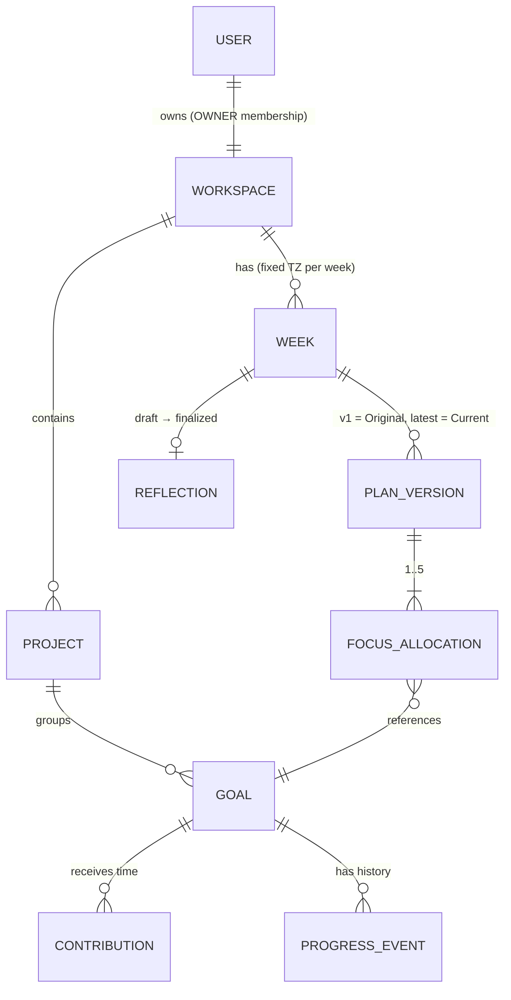

# Archipelago — Business Requirements

## 1. Purpose and vision

Archipelago is a personal-first web application that helps an individual align the time they actually invest with the priorities they chose, through the loop **Choose Focus → Invest Time → Reflect → Adjust**. A user organises Projects (areas of importance) and Goals (outcomes), chooses 1–5 Focus Goals for a week with planned attention shares, logs time manually as Contributions, tracks Goal progress independently of time, compares plan vs. actual on a dashboard, and closes each week with an optional written reflection and an irreversible finalization. It is explicitly **not** a task manager, automatic time tracker, or productivity-scoring tool (S10 §1–2). The product is also the **reference domain for an artifact-driven agentic SDLC harness** (derived from `ai/customer-portal`), so requirements must be precise enough to drive story → spec → design → plan → tests → code.

Success criteria:

- **SC-1** A user can confirm a weekly plan of 1–5 Goals with planned attention ≤100% (S6 §2.1; S10 §3).
- **SC-2** A user can log actual time, including work outside the weekly focus, and see it reflected in Actual Attention without page reload (S4; S7 §2 D4).
- **SC-3** A user can compare Original Plan and Current Plan against the same weekly actuals (S7 §2 D6, D23).
- **SC-4** A user can finalize any completed past week without being forced to write text (S8 D08, D28).
- **SC-5** The first MVP release ships with complete English and Ukrainian UI (S9).
- **SC-6** A returning user can log a Contribution in under 10 seconds (Q17/D16).

## 2. Sources and precedence

| ID | File (under `docs/input/`) | Date | Status | Kind | Precedence |
|----|------|------|--------|------|------------|
| S1 | `epic-01/EPIC-01_Authentication_and_User_Onboarding.md` | 2026-11-09 | Business rules + desktop UX approved; technical contracts proposed | epic spec | 1 |
| S2 | `epic-02/EPIC-02_Projects_Management.md` | 2026-11-09 | Business rules, flows, desktop design approved | epic spec | 1 |
| S3 | `epic-03/EPIC-03_Goals_Management.md` | 2026-11-09 | Business rules, flows, desktop design approved | epic spec | 1 |
| S4 | `epic-04/EPIC-04_Contributions_Management.md` | 2026-11-09 | Final product spec approved | epic spec | 1 |
| S5 | `epic-05/EPIC-05_Progress_Tracking.md` | 2026-11-09 | Discovery + desktop design approved | epic spec | 1 |
| S6 | `epic-06/EPIC-06_Weekly_Focus_Planning.md` | 2026-11-09 (v1.0) | Discovery + desktop design approved | epic spec | 1 |
| S7 | `epic-07/EPIC-07_Alignment_Dashboard.md` | 2026-11-09 | Discovery + desktop design approved | epic spec | 1 |
| S8 | `epic-08/EPIC-08_Weekly_Reflection.md` | 2026-11-09 | Design approved | epic spec | 1 |
| S9 | `LOCALIZATION_ALIGNMENT.md` | 2026-11-09 | Approved decision | decision log | 1 |
| S10 | `Archipelago_PRD_v1.1_Reconciled.docx` | 2026-11-09 (header still says "v1.0 · 8 Nov · Approved") | Reconciled **draft** — S9 states it is not formally approved | PRD | 2 |
| S11 | `AGENTS.md` | 2026-11-09 | Reconciled draft; architecture choices "still require ADR approval" | agent rules + architecture | 1 for stack/architecture as constraints; since 2026-11-10 it holds no product rules (they live only in this BRD and the epics) |
| S12 | `Archipelago_PRD_v1.0_EN (1).docx` | 2026-11-08 | Former approved baseline, partly superseded by S10/S1–S8 | PRD | 4 |
| S13 | Root mockups: `Archipelago Workspace Welcome Screen.png`, `Archipelago Alignment Dashboard.png`, `Alignment Dashboard Profile Menu.png` | n/a (mtime) | Visual reference, not tied to an epic | mockups | 5 |
| S14 | Epic mockups: 38 PNG files in `epic-01…epic-08/` (incl. 2 Google sign-in boards added 2026-11-10) (2 byte-identical duplicates: `Session Management Flow (1).png`, `Goals Dashboard-1.png`) | n/a | Approved "with corrections" per each epic's design-inventory section | mockups | 5 |

All 12 text sources were read in full; all 39 unique images were viewed (downscaled copies). Mockup discrepancies already listed in an epic's "approved corrections" are not repeated; only new ones are recorded in §11.

**Precedence rule applied:** approved epic specifications and the S9 decision win (text over images); where S10 (draft PRD v1.1) or S11 (agent rules) disagree with an epic, the epic wins; S12 (PRD v1.0) only fills gaps not covered by newer sources; mockups are illustrative only. Technical stack and architecture rules from S11 are recorded as constraints, not reopened.

## 3. Scope

### 3.1 In scope (MVP)

| Area | Epic | Source |
|---|---|---|
| Registration, login (email/password or Continue with Google), single session, email verification, password recovery, optional onboarding | EPIC-01 | S1; Q20–Q23 |
| Projects: create, list/filter, details, edit, archive, restore (no delete) | EPIC-02 | S2 |
| Goals: create, list/URL filters, edit metadata, complete, reopen, archive, restore (no delete, no move) | EPIC-03 | S3 |
| Contributions: manual time entries, historical entry, edit/delete in open weeks | EPIC-04 | S4 |
| Progress: manual absolute %, immutable Progress Events, history on Goal Details | EPIC-05 | S5 |
| Weekly Focus: 1–5 Goals, planned attention, versions, carry-forward, recommendations, plan vs actual | EPIC-06 | S6 |
| Alignment Dashboard: current/previous week, Original/Current vs Actual, rule-based insights | EPIC-07 | S7 |
| Weekly Reflection: optional answers, autosave, manual irreversible finalization, pending weeks | EPIC-08 | S8 |
| Settings & Localization: name, timezone, language, change password, email status, delete account | EPIC-09 (no separate document; specified in this BRD) | S1 §1, §9; S14; Q2/D2, Q5/D5, Q6/D6 |
| English (default) + Ukrainian UI in the first MVP release | cross-cutting | S9 |

### 3.2 Out of scope / later phases

- Team collaboration, invitations, role-management UI (OWNER Membership exists internally only) — S10 §4; S11 §1; S1 §2.
- Social login other than Google; unlinking or managing connected accounts; MFA, Remember Me — S1 §2; Q20/D18.
- Interactive archipelago map, gamification — S10 §4.
- Automatic timer, integrations, bulk contribution entry — S10 §4; S4 §1.
- AI insights/recommendations — S10 §4; S7 D10.
- Advanced historical analytics beyond current/previous week on the Dashboard — S7 §13; S6 §1.
- Dark theme — S10 §13.
- Deleting Projects or Goals; moving a Goal between Projects; moving a Contribution to another Goal — S2 §1; S3 §1.2; S4 §1.
- Reopening finalized weeks; automatic finalization; retrospective plan creation — S8 §2; S6 §1.
- Synthetic Alignment Score / productivity score — S7 D7; S10 §10.
- Real-time (Socket.IO) features — planned only, requires ADR — S11 §2, §3.13.
- Automatic translation of user-authored content — S9.
- Avatar upload (initials only) — Q5/D5.
- Data export — Could, post-MVP — Q6/D6.
- Admin role / admin UI / administration module — Q7/D7.
- AWS/Terraform production baseline — deferred to a future ADR — Q8/D8.

## 4. Actors and roles

| Actor | Description | Key goals | Business permissions |
|---|---|---|---|
| Visitor | Unauthenticated person | Register, sign in (email/password or Google), recover password, verify email | Public/auth pages only (S1) |
| User (Workspace Owner) | Registered individual; owns exactly one personal Workspace via an internal OWNER Membership | Plan weeks, log time, track progress, reflect | Full access to own Workspace data only; no access to any other Workspace (S1 REG-03; S2 PRJ-AC-036) |
| System — email dispatcher | Sends verification/reset emails after commit via transactional outbox | Reliable, non-duplicated delivery | No user data access beyond the message (S1 §7.10) |
| System — Google (external OIDC provider) | Authenticates the person for Continue with Google | Return a verified identity | Receives only the sign-in request; Archipelago keeps Google `sub`, email and name, no Google tokens (BR-033) |
| Operator (not a product role) | Person running the deployment; no in-app admin role, UI or module in MVP | Keep the service running | Operational runbooks only (Q7/D7) |

## 5. Glossary

| Term | Definition | Not to be confused with | Source |
|---|---|---|---|
| Workspace | Private container of a user's Projects and Goals; one personal Workspace per user in MVP | Team workspace (post-MVP) | S10 §5; S1 |
| Project | Strategic area of importance with Priority P1–P3 and an independent archive state | Goal | S2 |
| Goal | Desired outcome under exactly one Project; has Priority, Status, Archived flag, Progress, optional Deadline | Task | S3 |
| Priority | P1 (highest, "high focus"), P2 (medium), P3 (lower); required, no default | Weekly allocation | S2 PRJ-BR-011; S14 |
| Status (Goal) | Active or Completed | Archived (separate flag) | S3 §2.1 |
| Archived | Independent flag on Project or Goal; hides from active views, makes the entity read-only | Completed; Deleted | S2; S3 |
| Contribution | Manually recorded time (integer minutes) invested toward a Goal on an activity date | Progress Event | S4 |
| Progress | Manually set absolute integer % (0–100) of a Goal's completion; independent of time | Actual Attention | S5 |
| Progress Event | Immutable record of one successful Progress change (previous %, new %, server timestamp, note) | Contribution | S5 §2.2 |
| Week | Monday 00:00 (inclusive) to next Monday 00:00 (exclusive) in the timezone fixed for that week | ISO week number | S6 D1; S8 §4 |
| Weekly Plan | The set of confirmed versions for one week | Draft | S6 |
| Draft | Unsaved, client-only selection/allocation; never used for analytics | Plan Version | S6 §3; S7 AD-AC-50 |
| Carry Forward Draft | Draft prefilled from the immediately previous week's Current Plan | Confirmed plan | S6 D4, D17 |
| Plan Version | Immutable full snapshot of Focus Goals + Planned Attention + version number + server timestamp | Draft | S6 §3 |
| Original Plan | First confirmed version (v1) of a week | Current Plan | S6 D3 |
| Current Plan | Latest confirmed version of a week | Original Plan | S6 §3 |
| Focus Goal | Goal included in a confirmed plan version (1–5 per version) | Goal in general | S6 |
| Planned Attention | User-entered integer % (1–100) per Focus Goal | Expected Attention | S6 D6–D7 |
| Expected Attention | Advisory recommendation computed from priorities (40% Project / 60% Goal), normalized over selected Focus Goals; never auto-fills | Planned Attention | S6 D10, D31 |
| Actual Attention | A Goal's Contribution minutes ÷ all Contribution minutes in the week × 100 | Progress | S6 D26; S7 §4 |
| Tracked Time | Sum of all Contribution minutes in the week | — | S7 D13 |
| Focus Attention | Share of Tracked Time spent on Goals in the selected plan version | — | S7 D14 |
| Unplanned Attention | Share of Tracked Time spent on Goals outside the selected plan version (canonical term; replaces "Outside Focus" in S10/S11) | Unallocated planned % | S6 D27; S7 §4; C9 |
| Unallocated (planned) | 100 − total Planned Attention of a version | Unplanned Attention | S7 §4 |
| Needs Review | Status of a confirmed plan whose total Planned Attention is < 100% (valid) | Ineligible carried Goal warning | S6 D28; C6 |
| Deviation | Actual % − Planned %, in percentage points (pp) | Relative % change | S7 D8 |
| Pending Reflection | A past, not-yet-finalized week | Current week | S8 D04 |
| Finalized Week | Past week explicitly and irreversibly finalized; its historical data are immutable | Calendar-ended week | S8 |
| No Confirmed Plan / No Weekly Plan | State: week has no confirmed version | No Actual Data | S6 D23; S7 D11 |
| No Actual Data | State: Tracked Time = 0; actual shares undefined (not 0%) | 0.0% Actual of one Goal | S6 D29; S7 D12 |

## 6. Domain concepts

- **User / Workspace** — created atomically together with OWNER Membership at registration (email or Google); a User has an optional password and at most one linked Google identity (BR-033); never deleted in MVP (deletion: Q6). Source S1 REG-03.
- **Project** — create, edit (Active only), archive (confirm), restore (no confirm); no delete. Archiving does not cascade to Goals. Source S2 §3.
- **Goal** — belongs to one Project forever; Active → Completed (only at 100% + confirmation) → Active (Reopen); Archived flag independent; restore requires Active parent Project. Source S3 §2.
- **Contribution** — Goal fixed at creation; Date/Duration/Note editable only while week open and Goal/Project not archived; hard-deleted with confirmation; never touches Progress. Source S4.
- **Progress Event** — append-only; created only by Update Progress; never by Contributions, Reopen, or Reflection. Source S5.
- **Week** — identified by its local Monday (`YYYY-MM-DD`); timezone snapshotted per week; status: Current / Future / Past·Pending / Past·Finalized. Source S6 D32; S8 §4.
- **Plan Version** — immutable; created only by explicit Confirm/Save Changes for current/future weeks. Source S6.
- **Reflection** — one per week; server-autosaved draft (revisioned) → Finalized (irreversible), which locks the whole week. Source S8.

## 7. Business rules

### BR-001 — Atomic personal workspace provisioning
- **Rule:** Registration (email or Google) creates User, personal Workspace, OWNER Membership (plus the Google identity on the Google path) and an outbox event in one transaction; email is sent only after commit. A post-commit session failure must not re-create the account.
- **Source:** S1 REG-03, UF-01; S11 §3.9–3.10

### BR-002 — Password policy
- **Rule:** 8–128 characters; ≥1 uppercase, ≥1 lowercase, ≥1 digit, ≥1 special character; Confirm must match exactly. Applies to Registration, Reset, Change Password; not validated for strength at Login. Backend authoritative; frontend must accept/reject identically.
- **Example:** `Abcdef1!` valid; `abcdef1!` invalid (no uppercase).
- **Source:** S1 PWD-01–02 (mockup "6–15 chars, letter+number" superseded — S14)

### BR-003 — Session policy
- **Rule:** One active session per user (new login revokes others); absolute max 30 days; idle timeout 7 days; refresh rotation never extends the absolute deadline; password reset revokes all sessions.
- **Source:** S1 SES-01–05, RESET-03

### BR-004 — Email token lifetimes
- **Rule:** Verification link 24 h; reset link 30 min; both one-time, hashed, strictly before expiry; resend cooldown 60 s server-enforced; a new token invalidates prior unused ones. Verification consumed only by explicit POST.
- **Source:** S1 EV-02–04, RESET-02

### BR-005 — Account enumeration policy
- **Rule:** Login and Forgot Password responses never reveal whether an email exists. Exception (approved): registration shows "This email is already registered". Google linking (BR-033) reveals nothing extra: it needs control of the verified Google account for that email.
- **Source:** S1 REG-02, LOGIN-01, RESET-01

### BR-006 — Full Name
- **Rule:** Required; trimmed; 2–100 characters.
- **Source:** S1 REG-01; Q13/D12

### BR-007 — Project fields and uniqueness
- **Rule:** Name required, trimmed, 2–100 chars; unique per Workspace ignoring case and surrounding whitespace (concurrency-safe); Description optional ≤1,000; Priority P1/P2/P3 required with no preselection.
- **Example:** `Health` then ` health ` → second rejected.
- **Rule (cont.):** Names of archived Projects stay reserved.
- **Source:** S2 PRJ-BR-008–011; Q11/D10

### BR-008 — Goal fields and uniqueness
- **Rule:** Project required and immutable; Name 2–100 trimmed, unique per Project (case-insensitive); Description ≤1,000; Priority required, no default; Deadline optional (past allowed); initial state Active, not archived, 0%. Names of archived Goals stay reserved within their Project.
- **Source:** S3 §2.1; Q11/D10

### BR-009 — Project lifecycle
- **Rule:** Active ⇄ Archived; no Delete. Archived Project is read-only; blocks new Goals, new/edited/deleted Contributions and Progress updates for its Goals; does not change Goal status/flags or Weekly Focus; restore is immediate and does not restore archived Goals.
- **Source:** S2 §2–3; S4 §3; S5 §2.1.8

### BR-010 — Goal lifecycle and completion
- **Rule:** Status (Active/Completed) and Archived are independent. **Mark as Completed** only for an Active, non-archived Goal at 100% with confirmation; reaching 100% never completes automatically. Completed locks progress and blocks new Contributions until **Reopen**, which keeps progress and creates no Progress Event. Completed Goals may still have metadata edited.
- **Source:** S3 §2.2; S5 §2.1; S10 §6.2 (C1)

### BR-011 — Archive inheritance and restore order
- **Rule:** A Goal under an archived Project cannot be edited, completed, reopened, restored, progressed or receive Contributions. If both are archived: Restore Project, then Restore Goal.
- **Source:** S3 §2.3–2.4; S4 §3; S5 §2.1.8

### BR-012 — Contribution duration and note
- **Rule:** Integer minutes 1–1440 per entry (UI: Hours 0–24 + Minutes 0–59); Note optional ≤500; multiple entries per Goal per day allowed; daily total >24 h shows a non-blocking warning.
- **Example:** `24h 00m` valid; `24h 01m`, `0h 00m` invalid.
- **Source:** S4 §2

### BR-013 — Contribution date
- **Rule:** Not in the future; defaults to Today in the user's profile timezone; week membership uses that week's fixed timezone.
- **Source:** S4 §4

### BR-014 — Contribution eligibility (create/edit)
- **Rule:** Current Goal Active (not Completed, not Archived) and current Project Active; target week unfinalized; for dates on/after Goal creation the Goal must have been Active and not archived during part of that date; for dates before Goal creation the historical check is waived (approved exception).
- **Source:** S4 §3; S10 §6.3 (C2)

### BR-015 — Finalized-week immutability for Contributions
- **Rule:** No create/edit/delete in a finalized week; cross-week date change requires both weeks unfinalized, else the whole update is rejected atomically. Restoring an entity never unlocks a finalized Contribution.
- **Source:** S4 §3–4

### BR-016 — Progress value
- **Rule:** Absolute integer 0–100; may increase or decrease without confirmation; unchanged value cannot be saved; independent of Contributions in both directions.
- **Source:** S5 §2.1

### BR-017 — Progress Event
- **Rule:** Exactly one immutable event per successful change with previous %, new %, server timestamp, optional note ≤500. Events cannot be edited, deleted or backdated (no Effective Date); Contributions never create events; corrections append a new event. Event week = week containing its server timestamp.
- **Source:** S5 §2.2–2.3; Q1/D1

### BR-018 — Week definition and timezone
- **Rule:** Week = [Monday 00:00, next Monday 00:00) in the week's snapshotted IANA timezone; profile timezone change applies from the next calendar week and never re-buckets history. Week ID = local Monday date.
- **Rule (cont.):** The profile timezone is auto-detected from the browser at registration (fallback UTC) and editable in Settings.
- **Source:** S6 D1, D32; S10 §12; S8 D25; Q2/D2

### BR-019 — Weekly plan composition
- **Rule:** 1–5 unique Focus Goals; each Planned Attention integer 1–100; total ≤100 (above blocks confirm/save); total <100 is valid and marked **Needs Review** with the unallocated % shown.
- **Example:** 40+30+20 = 90 → Needs Review, 10% unallocated.
- **Source:** S6 D6–D8, D28; S10 §9 (C3)

### BR-020 — Plan timing and versioning
- **Rule:** Plans only for current and future weeks; past weeks read-only even if not finalized; no retrospective Original Plan. First Confirm = Original v1 = Current v1; each substantive Save Changes = new immutable version (unchanged save disabled). Stale concurrent saves rejected.
- **Source:** S6 D2–D3, D12–D16, D21–D24

### BR-021 — Carry forward
- **Rule:** Entering an unplanned current/future week prefills a client-only draft from the **immediately preceding** week's Current Plan (Goals + allocations); if that week has no confirmed plan, the draft is empty (older weeks not searched). Ineligible carried Goals stay visible with a warning and must be removed/replaced before first confirmation. Nothing is persisted or auto-confirmed.
- **Source:** S6 D4, D17–D20; supersedes S10 §9.2 (C7)

### BR-022 — Focus Goal eligibility
- **Rule:** Newly added Goals must be Active in an Active Project; Goals already in a confirmed plan that later become Completed/Archived may be retained in later versions with a warning.
- **Source:** S6 D5, D30

### BR-023 — Expected Attention recommendation
- **Rule:** Weight(i) = 0.4 × ProjectPriorityWeight(i) + 0.6 × GoalPriorityWeight(i); Expected(i) = Weight(i) / Σ Weight × 100%, over the currently selected Focus Goals; PriorityWeight P1=3, P2=2, P3=1; integer % by largest-remainder method summing to exactly 100, ties broken by Goal order in the plan; uses current priorities; advisory only, never auto-fills.
- **Example:** Goal A (Project P1, Goal P1) → 0.4·3+0.6·3 = 3.0; Goal B (P2, P3) → 0.4·2+0.6·1 = 1.4; Goal C (P3, P2) → 0.4·1+0.6·2 = 1.6; Σ = 6.0 → 50.0 / 23.33 / 26.67 → 50 / 23 / 27.
- **Source:** S6 §3, D25, D31; S10 §9.1; S12 §9.1; Q3/D3

### BR-024 — Actual, Focus and Unplanned Attention
- **Rule:** trackedMinutes = Σ minutes of all Contributions in week W. With a confirmed version V and trackedMinutes > 0: Actual(G) = 100·minutes(G)/tracked; Focus = 100·minutes(Goals ∈ V)/tracked; Unplanned = 100 − Focus. Classification is relative to the selected version (Original or Current). Progress never affects these values.
- **Source:** S6 §4.5; S7 §4; S8 §5.1

### BR-025 — Missing-data semantics
- **Rule:** No confirmed version → Focus/Unplanned/Deviation unavailable ("—"), never "100% Unplanned". trackedMinutes = 0 → "No Actual Data", never 0%. A planned Goal shows 0.0% Actual only when trackedMinutes > 0. Unplanned row Δ is "—".
- **Source:** S7 §4, D12, D16–D19; S8 §5.1

### BR-026 — Calculation precision
- **Rule:** Compute from exact integer minutes; display % and pp to one decimal; never adjust a row to force 100.0%; explain rounding differences in a tooltip.
- **Source:** S7 D15, D30

### BR-027 — Deviation and insights
- **Rule:** Deviation = Actual − Planned (pp). Insights are deterministic, rule-based, max 4, ordered: Missing Activity → Underallocated Plan → Unplanned Attention → deviations with |Δ| ≥ 10.0 pp (unrounded) by descending magnitude; deterministic tie-break (recommended Goal ID ascending — technical). No synthetic Alignment Score; no AI.
- **Example:** Planned 50%, Actual 40% → −10.0 pp → qualifies.
- **Source:** S7 D7–D8, D25–D27, D31, §5 Insights Rules

### BR-028 — Reflection eligibility
- **Rule:** Only weeks whose calendar end has passed; all past weeks from the user's first week of use; any order; never automatic; pending weeks never block current work.
- **Source:** S8 D01, D03–D04, D28. "First week of use": A2

### BR-029 — Finalization effects
- **Rule:** Manual, confirmed, atomic, idempotent, irreversible. Locks the week's Contributions, Progress Events, Original/Current plan versions and Reflection answers. The only exception to immutability is self-service account deletion (FR-046), which removes all of the user's data. Allowed without a plan and/or without Contributions. Any relevant data change after confirmation invalidates it and requires re-review.
- **Source:** S8 D09–D12, D21–D24, D27, D32; Q6/D6

### BR-030 — Historical weekly progress
- **Rule:** Start = latest Progress Event strictly before week start (else 0%); End = latest event strictly before week end (else Start); Change = End − Start (pp, may be negative). Goal set: deduplicated union of Original and Current Focus Goals; without a plan, Goals with Contributions or Progress Events in the week.
- **Source:** S8 D13–D16, D29–D30; S5 §2.3.5

### BR-031 — Reflection answers
- **Rule:** Three optional prompts ("What went well?", "What didn't go as planned?", "What will I change next week?"), ≤2,000 characters each incl. newlines; server autosave with revision check; Finalize disabled while unsaved.
- **Source:** S8 D07–D08, D17–D20, D31

### BR-032 — Localization
- **Rule:** UI available in English (default) and Ukrainian at first MVP launch; Ukrainian may be implemented after core epics but before launch; all strings externalized from the start; user-authored content never auto-translated; localization never changes calculations or stored values.
- **Source:** S9; S10 §12

### BR-033 — Google sign-in and account linking
- **Rule:** Continue with Google registers or signs in through one flow (OIDC, PKCE, `state`, `nonce`; scopes `openid email profile`). Google must report `email_verified = true` for creating or linking. Resolution order: known Google `sub` → sign in; else an account with the same email (case-insensitive) → link and sign in; else → create (BR-001). Linking marks the email Verified and invalidates pending verification tokens; if the target account was Unverified, its password is removed and its sessions are revoked first (pre-account takeover protection). After linking, `sub` identifies the account. A Google-registered account is Verified, has no password, and gets its Full Name from Google (A10). Google sign-in follows BR-003. Google tokens are never stored.
- **Example:** Ann registered with email + password and never verified; she clicks Continue with Google with the same verified Gmail → Google is linked, the email becomes Verified, the old password stops working and she is signed in.
- **Source:** Q20/D18, Q21/D19

## 8. Functional requirements

> Each FR lists its key acceptance criteria; the full acceptance lists in the referenced epic (e.g. `S4 CON-AC-01…42`) are part of the requirement by reference.

### 8.1 Identity and onboarding (EPIC-01)

#### FR-001 — Register
- **Priority:** Must · **Phase:** EPIC-01 · **Actor:** Visitor
- **Description:** Create an account and personal Workspace; be signed in immediately and land on Welcome.
- **Acceptance criteria:**
  - Given valid Full Name, Email, Password, Confirm and consent, when submitted, then User + Workspace + OWNER Membership exist and the user sees Welcome while Unverified.
  - Given an already registered email (any case), when submitted, then "This email is already registered" with a Login link is shown and nothing is created.
  - Given registration committed but session creation fails, when the user retries, then they are offered Login and no duplicate account is created.
  - Given the Google path, then FR-047 applies: consent is given by the button text, no password is set and the email is Verified.
- **Related rules:** BR-001, BR-002, BR-005, BR-006, BR-033 · **Source:** S1 §3.1, REG-AC-01–10

#### FR-002 — Sign in
- **Priority:** Must · **Phase:** EPIC-01 · **Actor:** Visitor
- **Acceptance criteria:**
  - Given wrong email or password, when submitted, then the same "Invalid email or password" message appears.
  - Given valid credentials, when submitted, then previous sessions are revoked and the user lands on `/dashboard`.
  - Given repeated failures, then server-side rate limiting/slowdown applies without permanent lockout.
  - Given a Google-only account (no password), when email + any password is submitted, then "Invalid email or password" appears.
- **Related rules:** BR-003, BR-005, BR-033 · **Source:** S1 §3.3, LOGIN-AC-01–08

#### FR-003 — Session expiry and recovery
- **Priority:** Must · **Phase:** EPIC-01
- **Acceptance criteria:**
  - Given an idle (7 d), expired (30 d) or replaced session, when a protected page/API is used, then access is denied and "Session Expired" is shown without a Dashboard bypass.
  - Given re-authentication after expiry, then the user returns to the previous internal, still-authorized URL, else `/dashboard`.
- **Related rules:** BR-003 · **Source:** S1 SES-AC-01–12

#### FR-004 — Sign out
- **Priority:** Must · **Phase:** EPIC-01
- **Acceptance criteria:** Given a signed-in user, when Log out is selected in the header profile menu (FR-045), then the server session is revoked, other tabs lose access, and Login shows "You have been signed out".
- **Source:** S1 SES-03, UF-04

#### FR-005 — Verify email (non-blocking)
- **Priority:** Must · **Phase:** EPIC-01
- **Acceptance criteria:**
  - Given an unverified user, then all MVP features are available and a dismissible (per session) Dashboard banner is shown.
  - Given a valid link, when opened, then nothing changes until the user presses Verify Email (POST).
  - Given resend within 60 s, then it is refused; a new link invalidates the old one.
- **Related rules:** BR-004 · **Source:** S1 EV-01–07, EV-AC-01–12

#### FR-006 — Recover password
- **Priority:** Must · **Phase:** EPIC-01
- **Acceptance criteria:**
  - Given any email, when Forgot Password is submitted, then the same neutral confirmation appears.
  - Given a valid reset link (<30 min), when a compliant new password is set, then all sessions are revoked and the user is sent to Login (no auto sign-in).
  - Given a Google-only account, then the response is the same and the reset link sets its first password; Google stays linked (D20).
- **Related rules:** BR-002, BR-004, BR-005 · **Source:** S1 RESET-01–04, RESET-AC-01–11

#### FR-007 — Optional guided onboarding
- **Priority:** Should · **Phase:** EPIC-01
- **Description:** Welcome → Create First Project → Create First Goal → Set Weekly Focus → Dashboard; every step skippable.
- **Acceptance criteria:**
  - Given any onboarding step, when Skip Setup is chosen, then the user lands on Dashboard and already-saved records remain.
  - Given onboarding is skipped entirely, then Dashboard shows the empty state with Create First Project.
  - Weekly Focus step follows EPIC-06 (1–5 Goals); no "up to 3" limit.
  - Given the user leaves onboarding, then it is not offered again on later sign-ins.
- **Source:** S1 ONB-01–06, ONB-AC-01–29; Q12/D11

#### FR-047 — Continue with Google
- **Priority:** Must · **Phase:** EPIC-01 · **Actor:** Visitor, System — Google
- **Description:** Register or sign in with a Google account from Registration, Login or Session Expired.
- **Acceptance criteria:**
  - Given a new Google identity with a verified email, when the flow completes, then User + Workspace + OWNER Membership are created atomically, the email is Verified, no verification email is sent and Welcome opens.
  - Given a known Google identity, then previous sessions are revoked and the user lands on `/dashboard` (or the safe return URL after Session Expired).
  - Given a verified Google email that matches an existing account, then Google is linked and the user is signed in; an Unverified target loses its password and sessions first.
  - Given the user cancels, Google fails or the email is not verified at Google, then nothing is created or linked and the starting page shows "Couldn't sign in with Google. Try again or use your email."
  - Given Login, Registration or Session Expired, then Continue with Google is shown at the top, above an "or" divider and the email form.
  - Given Registration, then the line "By continuing with Google, you agree to the Terms of Service and Privacy Policy" is shown directly under the Google button, above the divider.
- **Related rules:** BR-001, BR-003, BR-033 · **Source:** S1 §3.8, GOOG-AC-01–12; Q20–Q23

### 8.2 Settings and localization (EPIC-09 — specified here; no separate epic document per D4)

#### FR-008 — Profile and timezone
- **Priority:** Must · **Phase:** EPIC-09
- **Description:** View/edit Full Name and Timezone; timezone drives week boundaries and "today".
- **Acceptance criteria:**
  - Given a new registration, then the timezone is pre-set from the browser (UTC if unavailable).
  - Given a timezone change, when saved, then it applies from the next calendar week; past and current weeks keep their timezone.
  - Given Full Name outside BR-006 limits, then an inline error appears.
- **Related rules:** BR-006, BR-018 · **Source:** S10 §12; S14; Q2/D2, Q5/D5

#### FR-009 — Switch interface language
- **Priority:** Must · **Phase:** EPIC-09 / hardening
- **Acceptance criteria:**
  - Given the language toggle in the header or Settings, when changed, then all UI text switches without data changes; user content is not translated.
  - Given the user signs in on another device, then the saved language preference is applied.
- **Source:** S9; S10 §12; S13; Q5/D5

#### FR-010 — Change password
- **Priority:** Must · **Phase:** EPIC-09
- **Acceptance criteria:**
  - Given current password + a BR-002-compliant new password, when saved, then the password changes, the current session stays active and all other sessions are revoked.
  - Given a wrong current password, then the change is rejected without revealing details.
  - Given a Google-only account (no password), then Change Password is not shown; a first password is set via Forgot Password (FR-006, D20).
- **Source:** S1 §2; Q5/D5; Q22/D20

#### FR-011 — Email verification status and resend on the Account page
- **Priority:** Must · **Phase:** EPIC-09
- **Acceptance criteria:** The Account page (A9) always shows Verified/Unverified; resend follows BR-004 cooldown. Accounts registered or linked with Google show Verified and "Signed in with Google".
- **Source:** S1 EV-05, EV-AC-09, UI-13

#### FR-046 — Delete account
- **Priority:** Must · **Phase:** EPIC-09
- **Description:** A user can permanently delete their account and all their data.
- **Acceptance criteria:**
  - Given the user re-enters their password and explicitly confirms, when Delete Account is submitted, then the User, Workspace and all Projects, Goals, Contributions, Progress Events, plans and Reflections are permanently deleted and all sessions are revoked.
  - Given deletion succeeded, then the same email can register again as a new account.
  - Given a wrong password or cancelled confirmation, then nothing is deleted.
  - Given a Google-only account, then a fresh Google sign-in (at most 5 minutes old) replaces password re-entry; a cancelled or stale re-authentication deletes nothing.
- **Source:** Q6/D6; Q23/D21

### 8.3 Projects (EPIC-02)

#### FR-012 — Create Project
- **Priority:** Must · **Phase:** EPIC-02
- **Acceptance criteria:** Given valid Name/Priority, when created, then the Project is Active and the user lands on `/projects/[id]`; given a duplicate normalized name, then an inline error appears and values are kept.
- **Related rules:** BR-007 · **Source:** S2 UF-01, PRJ-AC-001–008

#### FR-013 — List and filter Projects
- **Priority:** Must · **Phase:** EPIC-02
- **Acceptance criteria:** Table Name/Priority/Goals Count/Actions; filters Active/Archived/All; order P1→P3 then Name A–Z; Goals Count includes archived Goals; default view Active.
- **Source (default):** Q15/D14
- **Source:** S2 PRJ-AC-009–015

#### FR-014 — Edit Project
- **Priority:** Must · **Phase:** EPIC-02
- **Acceptance criteria:** Only Active Projects; Priority change updates recommendations but not saved plan versions; archived-meanwhile update is rejected.
- **Source:** S2 PRJ-AC-016–021

#### FR-015 — Archive and restore Project
- **Priority:** Must · **Phase:** EPIC-02
- **Acceptance criteria:** Archive requires confirmation explaining effects; Cancel changes nothing; restore is immediate with a toast; Goals keep their own states.
- **Related rules:** BR-009 · **Source:** S2 PRJ-AC-022–034

### 8.4 Goals (EPIC-03)

#### FR-016 — Create Goal
- **Priority:** Must · **Phase:** EPIC-03
- **Acceptance criteria:** From `/goals/create` the Project is chosen manually; from Project Details `/goals/create?projectId=` preselects it; archived/foreign `projectId` never bypasses eligibility.
- **Related rules:** BR-008 · **Source:** S3 GF-01–02, GOAL-AC-01–11

#### FR-017 — Goals list with URL filters
- **Priority:** Must · **Phase:** EPIC-03
- **Acceptance criteria:** Filters `view`, `status`, `projectId`, `priority` combinable, in URL, survive refresh/Back/Forward, Clear removes them, invalid values handled gracefully; absent `view` = active.
- **Source (default):** Q15/D14
- **Source:** S3 §3.1, GOAL-AC-12–19

#### FR-018 — Edit Goal metadata
- **Priority:** Must · **Phase:** EPIC-03
- **Acceptance criteria:** Active or Completed Goal; Name/Description/Priority/Deadline only; Project read-only; no progress control on this page.
- **Source:** S3 GF-04, GOAL-AC-20–21

#### FR-019 — Complete and reopen Goal
- **Priority:** Must · **Phase:** EPIC-03
- **Acceptance criteria:** Mark as Completed visible only at 100% for an eligible Active Goal and requires confirmation; Reopen keeps progress and creates no event.
- **Related rules:** BR-010 · **Source:** S3 GF-05–06, GOAL-AC-22–26

#### FR-020 — Archive and restore Goal
- **Priority:** Must · **Phase:** EPIC-03
- **Acceptance criteria:** Archive Active or Completed Goal with confirmation; Goal stays in current Weekly Focus with an Archived warning; Restore blocked while Project archived.
- **Related rules:** BR-011 · **Source:** S3 GF-07–08, GOAL-AC-27–37

#### FR-021 — Overdue indicator
- **Priority:** Could · **Phase:** EPIC-03
- **Acceptance criteria:** Given an Active, non-archived Goal with Deadline before today, then "Overdue" is shown without changing status; Completed or Archived Goals never show it.
- **Source:** S3 §2.5; Q14/D13

### 8.5 Contributions (EPIC-04)

#### FR-022 — Add Contribution
- **Priority:** Must · **Phase:** EPIC-04
- **Acceptance criteria:**
  - Given an eligible Goal, when Goal/Date/Duration are entered in the dialog (from `/contributions` or Goal Details), then it is saved, the dialog closes, aggregates refresh and a toast appears.
  - Given the day total would exceed 24 h, then a warning is shown and saving is still allowed.
  - Given a finalized week, a future date, or a historically inactive Goal, then specific errors appear ("Week finalized", "Future dates are not allowed", "Goal was not active on this date").
- **Related rules:** BR-012–BR-015 · **Source:** S4 CF-01–02, CF-06, CON-AC-01–17

#### FR-023 — Browse and filter Contributions
- **Priority:** Must · **Phase:** EPIC-04
- **Acceptance criteria:** Columns Date/Goal/Project/Duration/Note/Actions; URL filters `from`,`to`,`projectId`,`goalId`; newest first; finalized rows marked read-only; default range = current week; 25 rows per page.
- **Source (defaults):** Q16/D15
- **Source:** S4 §5, CON-AC-33–39

#### FR-024 — Edit Contribution
- **Priority:** Must · **Phase:** EPIC-04
- **Acceptance criteria:** Goal locked; Date/Duration/Note editable; cross-week move only if both weeks open, else whole update rejected.
- **Source:** S4 CF-04, CF-07, CON-AC-19–26

#### FR-025 — Delete Contribution
- **Priority:** Must · **Phase:** EPIC-04
- **Acceptance criteria:** Confirmation states that Progress Events are not affected; blocked in finalized weeks or for archived Goal/Project.
- **Source:** S4 CF-05, CON-AC-29–31

### 8.6 Progress (EPIC-05)

#### FR-026 — Update Goal progress
- **Priority:** Must · **Phase:** EPIC-05
- **Acceptance criteria:** Dialog with synced slider + integer input (0–100) and optional note; unchanged value cannot be saved; save atomically updates progress and appends one event; stale save rejected with "Reload Current Progress".
- **Related rules:** BR-016, BR-017 · **Source:** S5 PF-01–06, PRG-AC-01–17, 35–40

#### FR-027 — Progress history
- **Priority:** Must · **Phase:** EPIC-05
- **Acceptance criteria:** Section on Goal Details (not a tab/page); newest first; 10 per page with Load More; signed change; per-event Finalized marker.
- **Source:** S5 §2.2, PF-04, PRG-AC-18–20, 29–33

### 8.7 Weekly Focus (EPIC-06)

#### FR-028 — Create and confirm weekly plan
- **Priority:** Must · **Phase:** EPIC-06
- **Acceptance criteria:** Given 1–5 eligible Goals with valid allocations, when Confirm is pressed for a current/future week, then Original v1 = Current v1 is stored; total >100 disables confirmation; total <100 confirms as Needs Review.
- **Related rules:** BR-019, BR-020, BR-022 · **Source:** S6 WF-01, WF-06–07, WF-AC-01–11

#### FR-029 — Carry forward previous focus
- **Priority:** Must · **Phase:** EPIC-06
- **Acceptance criteria:**
  - Given the previous week has a Current Plan, when an unplanned current/future week is opened, then its Goals and allocations prefill an unsaved draft labelled with the source week/version.
  - Given a carried Goal is now Completed/Archived, then it shows a warning and Confirm stays disabled until it is removed or replaced.
  - Given the previous week has no confirmed plan, then the draft is empty.
- **Related rules:** BR-021 · **Source:** S6 WF-02–03, WF-AC-21–26

#### FR-030 — Revise plan and view version history
- **Priority:** Must · **Phase:** EPIC-06
- **Acceptance criteria:** Save Changes enabled only on substantive valid change → vN+1; Version History shows number, server timestamp, read-only snapshot; unsaved navigation prompts Stay/Discard.
- **Source:** S6 WF-04–05, WF-10, WF-AC-12–20

#### FR-031 — Expected Attention recommendations
- **Priority:** Must · **Phase:** EPIC-06
- **Acceptance criteria:**
  - Given selected Goals with (Project, Goal) priorities (P1,P1), (P2,P3), (P3,P2), then Expected shows 50 / 23 / 27 and Planned inputs are not changed.
  - Given a priority changes after confirmation, then recommendations update and saved versions do not.
- **Related rules:** BR-023 · **Source:** S6 WF-AC-33–35

#### FR-032 — Week navigation and past/future weeks
- **Priority:** Must · **Phase:** EPIC-06
- **Acceptance criteria:** `/weekly-focus?week=YYYY-MM-DD` (Monday) is the source of truth; past weeks read-only with "Past Week · Not Finalized/Finalized"; future weeks plannable.
- **Source:** S6 WF-09, WF-11–12, WF-AC-27–32

#### FR-033 — Plan vs actual on Weekly Focus page
- **Priority:** Must · **Phase:** EPIC-06
- **Acceptance criteria:**
  - Given a confirmed plan and logged time, then Original vs Actual and Current vs Actual are shown, with Unplanned Attention as a separate row.
  - Given no Contributions in the week, then "No Actual Data" is shown instead of 0%.
- **Related rules:** BR-024, BR-025 · **Source:** S6 WF-08, WF-AC-36–40

### 8.8 Alignment Dashboard (EPIC-07)

#### FR-034 — Dashboard landing and period
- **Priority:** Must · **Phase:** EPIC-07
- **Acceptance criteria:** Login lands on `/dashboard`; `period=current|previous` in URL (default current); sections Summary → Comparison → Focus Goals → Insights.
- **Source:** S7 D1–D3, D32, AD-AC-01–09

#### FR-035 — Summary and attention comparison
- **Priority:** Must · **Phase:** EPIC-07
- **Acceptance criteria:** Tracked Time / Focus / Unplanned cards; Current Plan vs Actual default, Original toggle reclassifies Focus/Unplanned without changing Tracked Time.
- **Related rules:** BR-024–BR-026 · **Source:** S7 AD-AC-10–24, 43–44

#### FR-036 — Focus Goals panel
- **Priority:** Must · **Phase:** EPIC-07
- **Acceptance criteria:** All Goals of the selected snapshot incl. Completed/Archived, with Project, status, Planned/Actual, optional Progress, link to Goal Details.
- **Source:** S7 D9, AD-05, AD-AC-22

#### FR-037 — Rule-based insights
- **Priority:** Must · **Phase:** EPIC-07
- **Acceptance criteria:**
  - Given a Goal with Planned 50% and Actual 40.0%, then a deviation insight "−10.0 pp" appears; at 9.99 pp it does not.
  - Given more than four applicable insights, then only four are shown in the order Missing Activity → Underallocated → Unplanned → deviations.
- **Related rules:** BR-027 · **Source:** S7 AD-AC-35–42, 45–46

#### FR-038 — Empty and historical dashboard states
- **Priority:** Must · **Phase:** EPIC-07
- **Acceptance criteria:** Distinct states for No Weekly Plan, No Actual Data, Empty, Previous·Not Finalized, Previous·Finalized; Add Contribution only when an eligible Goal exists.
- **Source:** S7 §5 table, AD-AC-25–34

#### FR-039 — Auto-refresh with transient "Updated" notice
- **Priority:** Should · **Phase:** EPIC-07
- **Acceptance criteria:** Given a Contribution or plan is saved, when the Dashboard is shown, then values are recalculated and a transient "Updated" notice appears; a plain reload never shows it.
- **Source:** S7 D4, §5, AD-AC-47

### 8.9 Weekly Reflection (EPIC-08)

#### FR-040 — Reflection overview and pending weeks
- **Priority:** Must · **Phase:** EPIC-08
- **Acceptance criteria:** `/reflection` lists past weeks with Pending/Finalized; `?week=YYYY-MM-DD` opens a week; Dashboard "Review Week" preserves week context.
- **Related rules:** BR-028 · **Source:** S8 WR-01–02, WR-14, WR-AC-01–07

#### FR-041 — Weekly review (attention + progress)
- **Priority:** Must · **Phase:** EPIC-08
- **Acceptance criteria:**
  - Given a pending week, then attention uses the same formulas as the Dashboard with an Original/Current toggle.
  - Given a Goal with last event 20% before the week and 35% inside it, then Start 20%, End 35%, Change +15 pp; with no event inside the week, Change 0 pp.
  - Given the toggle is switched, then the Progress Review Goal set does not change.
- **Related rules:** BR-024–BR-026, BR-030 · **Source:** S8 WR-03–04, WR-AC-08–18, 41–42

#### FR-042 — Reflection answers with autosave
- **Priority:** Must · **Phase:** EPIC-08
- **Acceptance criteria:** Saving…/Saved/Save Failed + Retry; stale revision rejected with reload option; no Discard Changes action.
- **Related rules:** BR-031 · **Source:** S8 WR-05–08, WR-15, WR-AC-19–26, 43

#### FR-043 — Finalize week
- **Priority:** Must · **Phase:** EPIC-08
- **Acceptance criteria:** Confirmation lists locked data; success shown only after server commit; on conflict, refreshed review + reconfirmation; on server error only "Retry Finalization"; allowed without plan/activity.
- **Related rules:** BR-029 · **Source:** S8 WR-09–12, WR-16, WR-AC-27–40, 44–45

### 8.10 Cross-cutting

#### FR-044 — Bilingual UI (en/uk)
- **Priority:** Must · **Phase:** all epics; release gate
- **Acceptance criteria:** Before first launch, navigation, forms, validation, errors, analytics, Weekly Focus and Reflection are complete in en and uk; en default; layouts don't clip in either language.
- **Related rules:** BR-032 · **Source:** S9; S10 §12–13; label wording: A4

#### FR-045 — Global navigation
- **Priority:** Must · **Phase:** cross-cutting
- **Description:** Authenticated app shell (reference mockups: `docs/design/mockups/general/alignment-dashboard*.png`): a top header with the logo, the EN / УКР language toggle and the profile menu; a collapsible left sidebar with the main destinations Dashboard, Projects, Goals, Contributions, Weekly Focus, Reflection, and a separate **Workspace** group with Settings and Account. Auth pages and Welcome use a centered layout without sidebar.
- **Acceptance criteria:**
  - Given a signed-in user, then the sidebar shows the six main destinations in this order, followed by the Workspace group (Settings, Account), and a Collapse control.
  - Given the user clicks the avatar/name in the header, then a dropdown opens with the user's name and "Personal Workspace" and a **Log out** action (FR-004) — the only logout entry point; it also offers shortcuts Account Settings, Security, Email (→ Account) and Preferences (→ Settings) per A9.
  - Given a Visitor or the Welcome/onboarding screens, then no sidebar is shown.
- **Source:** S1 §8; S10 §13; S11 §5.1; C11, C12; A3, A9; Q19/D17

## 9. Non-functional requirements (business-facing)

### NFR-001 — Credential isolation
- **Requirement:** The browser only ever holds an opaque HttpOnly Secure session cookie (plus a short-lived HttpOnly cookie during the Google flow); access/refresh tokens, Google codes and ID tokens never reach client code, storage or responses.
- **Source:** S1 SES-05; S11 §3.3

### NFR-002 — Workspace isolation
- **Requirement:** Every read and write is authorized server-side against the user's Workspace; guessing IDs grants nothing; UI visibility is not authorization.
- **Source:** S2 PRJ-AC-036; S3 GOAL-AC-39; S11 §7

### NFR-003 — Integrity under concurrency
- **Requirement:** Name uniqueness, progress updates, plan versions, reflection drafts and finalization are safe under concurrent requests; stale writes are rejected, never silently overwritten; finalized history cannot be modified by a race.
- **Source:** S2 PRJ-AC-038; S4 CON-AC-41; S5 PRG-AC-36; S6 §4.3; S8 §7.2

### NFR-004 — Privacy in diagnostics
- **Requirement:** Passwords, tokens (including Google codes and ID tokens), session IDs and reflection text never appear in logs or analytics.
- **Source:** S10 §16; S11 §7

### NFR-005 — Accessibility
- **Requirement:** WCAG 2.2 AA target; keyboard operation, visible focus, status not conveyed by color alone, accessible charts/tables.
- **Source:** S10 §13

### NFR-006 — Devices
- **Requirement:** Responsive web. Login, Add Contribution, Dashboard and Reflection fully usable at 360 px width; no screen has horizontal page scroll at 360 px.
- **Source:** S10 §13; Q9/D9

### NFR-007 — Visual direction
- **Requirement:** Light theme only; white/gray surfaces with orange accent; compact Grafana-inspired hierarchy; orange is not an error color.
- **Source:** S10 §13; S3 §6.1

### NFR-008 — Abuse protection
- **Requirement:** Server-side rate limiting and progressive slowdown on login, verification resend and reset; no permanent lockout.
- **Source:** S1 LOGIN-04, §7.5

### NFR-009 — Scale
- **Requirement:** Designed for ~20–100 users in the initial release.
- **Source:** S11 §1

### NFR-010 — Performance and availability targets
- **Requirement:** p95 API latency < 300 ms at 100 users; Dashboard first meaningful render < 2 s; Add Contribution completable in < 10 s by a returning user; availability best-effort; daily DB backup kept 30 days.
- **Source:** Q17/D16

### NFR-011 — Data retention, export and deletion
- **Requirement:** User data is kept until the user deletes the account (FR-046); deletion is permanent in the live database; backups containing deleted data expire per the backup retention policy (A8). Export is post-MVP.
- **Source:** Q6/D6

## 10. Constraints

- **Stack (S11 §2):** pnpm + Turborepo monorepo, TypeScript strict; Next.js App Router + React + Tailwind + shadcn/ui + TanStack Query (+ Zustand only for UI state) + React Hook Form + Zod; NestJS modular monolith, REST `/api/v1`, OpenAPI, Prisma, PostgreSQL, `class-validator`.
- **Architecture (S11 §3; S1 §6):** Next.js is a thin BFF; NestJS is the sole authority for auth, authorization and business rules; separate PostgreSQL schemas `app` / `bff` with separate credentials; OpenAPI-generated client is server-only; transactional outbox for email; DDD-lite modules without cycles or `forwardRef()`.
- **Infrastructure (Q8/D8, supersedes S11 §2 for MVP):** local Docker Compose (PostgreSQL + Mailpit); production on a single VPS with Docker Compose + Caddy; email via SMTP provider behind an email port; GitHub Actions CI. AWS (EC2/ECR/S3/SES/CloudWatch/SSM), Terraform and OIDC deferred to a future ADR.
- **No admin surface (Q7/D7):** no `app/admin/` routes or `administration` module in MVP.
- **Documentation language:** English; agent conversation language: Ukrainian (S11; skill convention).
- **Localization:** en default + uk mandatory at first launch (S9).
- **Harness:** delivery follows the artifact-driven workflow from `ai/customer-portal` (story → clarification → spec → API/DB design → review → impact → plan → tests → implementation → verification → security → reconciliation → PR), adapted from Spring Boot to the stack above.

## 11. Conflicts between sources

### C1 — Goal completion below 100%
- **Sources:** S12 §6.2 allows completion below 100%; S10 §6.2, S3 §2.2, S5 §2.1 require 100% + confirmation.
- **Resolution:** S3/S5 win (precedence). Answered-from-source (Q18).
- **Business impact:** BR-010.

### C2 — New Contributions to a Completed Goal
- **Sources:** S12 §6.3 allows late contributions to a Completed Goal; S10 §6.3, S4 §3 require Reopen first.
- **Resolution:** S4 wins. Answered-from-source (Q18).
- **Business impact:** BR-014.

### C3 — Weekly allocation must total exactly 100%
- **Sources:** S12 §9, §15 "exactly 100%"; S6 D8, D28 and S10 §9 "≤100%, <100% = Needs Review"; S10 §3 still says "allocate 100% of planned attention" (stale line).
- **Resolution:** S6 wins; S10 §3 to be corrected.
- **Business impact:** BR-019, SC-1.

### C4 — Priority weights and rounding for Expected Attention
- **Sources:** S12 §9.1: P1=3, P2=2, P3=1, largest-remainder rounding, plan-order tie-break; S10 §9.1, S6 §3, S11 §5.1: mapping and rounding "not yet approved".
- **Resolution:** Q3/D3 — adopt S12's mapping and rounding.
- **Business impact:** BR-023, FR-031.

### C5 — Backdated Progress Events (Effective Date)
- **Sources:** S10 §8 and §15, S11 §5.1, S12 §8: events have Recorded At + Effective Date, past effective dates allowed in unfinalized weeks, "a contribution may optionally initiate" a Progress Event; S5 §1, §2.2, PRG-AC-14–15 and S8 D13–D14: no backdating, server timestamp only; S4/S5: Contributions never create Progress Events.
- **Resolution:** Q1/D1 — S5 wins: no backdating, no Effective Date, Contributions never create events.
- **Business impact:** BR-017, BR-030, FR-026; what users can record.

### C6 — Meaning of "Needs Review"
- **Sources:** S10 §9.2: a carried-forward draft whose sum ≠ 100%; S6 D28, S7: a confirmed plan totalling <100%.
- **Resolution:** S6 wins; ineligible carried Goals use a separate blocking warning (S6 D18).
- **Business impact:** glossary; BR-019, BR-021.

### C7 — Automatic carry-forward of a plan
- **Sources:** S10 §9.2 "If no new plan is created, eligible goals and their percentages are carried from the prior week unchanged"; S6 D4, D20, D23, WF-AC-23: UI-only draft, never auto-confirmed; a week without confirmation has No Confirmed Plan.
- **Resolution:** S6 wins.
- **Business impact:** BR-021; analytics never use unconfirmed plans (S7 AD-AC-50).

### C8 — Replacement offer when 5 Goals already selected
- **Sources:** S10 §9 "if five goals already exist, the UI offers replacement"; S6 only blocks the 6th.
- **Resolution:** keep as a UX hint (Could), no business rule change — A5.
- **Business impact:** none.

### C9 — "Outside Focus" vs "Unplanned Attention"
- **Sources:** S10 §9–10, S11 §5.1 use "Outside Focus"; S6, S7, S8 use "Unplanned Attention".
- **Resolution:** canonical term **Unplanned Attention**.
- **Business impact:** terminology only.

### C10 — Editing/deleting Contributions of archived Goals/Projects
- **Sources:** S10 CT-05 restricts only finalized weeks; S4 §3, CON-AC-26 also block edit/delete while Goal or Project is archived.
- **Resolution:** S4 wins.
- **Business impact:** BR-009, FR-024–025.

### C11 — Welcome screen layout and CTA
- **Sources:** S13 Welcome mockup shows the authenticated sidebar and "Go to Dashboard"; S1 UI-05, UI-AC-06/07 require no sidebar and "Skip for Now".
- **Resolution:** S1 wins (text over image).
- **Business impact:** FR-007, FR-045.

### C12 — Navigation labels and order
- **Sources:** S11 §5.1 and S1 §8: Dashboard, Weekly Focus, Projects, Goals, Contributions, Reflections, Settings; S7 §5: Dashboard, Projects, Goals, Contributions, Weekly Focus, Reflection; S13/S14 mockups mix "Reflection"/"Reflections", "Home", and add a separate "Account" item; route is `/reflection` (S8).
- **Resolution:** D17 (user-approved reference mockups), A3 label rule, A9.
- **Business impact:** FR-045.

### C13 — Removing a Goal from Weekly Focus "in Reflection"
- **Sources:** S3 §2.4 and GOAL-AC-32 ("until manual plan change or Reflection"), S14 archived-Goal mockup ("remove it … in Reflection"); S8 §1/§11 and S6 D21: Reflection never changes plans; past plans are read-only.
- **Resolution:** S8/S6 win; drop "or Reflection" wording.
- **Business impact:** none beyond wording; prevents a false requirement.

### C14 — "Finalized current week" in EPIC-05
- **Sources:** S5 §2.3 rule 4 and QA "Current finalized week prevents creation of a new Event"; S8 D01: the current week can never be finalized.
- **Resolution:** S8 wins; rule 4 is unreachable and should be reworded as a defensive server check.
- **Business impact:** none.

### C15 — EPIC-01 stale localization wording
- **Sources:** S1 UI-AC-05 "messages are provided in English for the initial release … support later Ukrainian"; S9 requires both languages at first MVP release.
- **Resolution:** S9 wins.
- **Business impact:** FR-044.

### C16 — PRD v1.1 header and approval status
- **Sources:** S10 header "Version 1.0 · 8 November 2026 · Approved"; S9 "does not assert … the PRD draft has been formally approved".
- **Resolution:** treat S10 as draft v1.1; correct the header.
- **Business impact:** documentation only.

### C17 — AGENTS.md references
- **Sources:** S11 §5.1 titled "(PRD v1.0)" but contains v1.1 rules; §10 cites "approved PRD v1.0" and ADR-011/015/016, which are not in the inputs.
- **Resolution:** correct titles; mark ADRs as "to be created".
- **Business impact:** none (agent guidance accuracy).

### C18 — Description length in onboarding mockup
- **Sources:** S14 onboarding mockup counter "0/300"; S2 PRJ-BR-010 ≤1,000.
- **Resolution:** S2 wins (S1 ONB-04 defers to EPIC-02).
- **Business impact:** none.

### C19 — Dashboard week arrows vs two-period scope
- **Sources:** S13/S14 dashboard mockups show ‹ › arrows around the date range; S7 D2, §13: only Current and Previous Week in MVP.
- **Resolution:** S7 wins; arrows (if kept) only toggle between the two periods — A6.
- **Business impact:** FR-034.

### C20 — Unspecified UI elements in mockups
- **Sources:** S14/S13 show a notification bell, help icon, avatar upload (Account Settings), "Your Projects" and "Next Steps" dashboard panels, Goal "Activity" feed, Reflection "History" tab; no text source specifies them.
- **Resolution:** not requirements unless approved — A7; avatar upload folded into Q5.
- **Business impact:** scope control.

## 12. Assumptions

- `A1 (S11 §2):` The user's own stack equals the S11 stack (Next.js + NestJS + Prisma + PostgreSQL); the harness skills will be adapted from Spring Boot to it.
- `A2 (S8 D03):` "User's first week of app use" = the calendar week (in the registration timezone) containing account creation.
- `A3 (C12, superseded by D17):` ~~Canonical sidebar: Dashboard, Weekly Focus, Projects, Goals, Contributions, Reflection, Settings; no separate "Account" nav item.~~ Kept: label `Reflection` (`/reflection`), not "Reflections" or "Home".
- `A9 (D17):` Content split between the two Workspace pages: **Account** = Full Name, email status/resend, Change Password, account deletion (FR-008 name part, FR-010, FR-011, FR-046); **Settings** = timezone and interface language (FR-008 timezone part, FR-009). Profile menu: Account Settings / Security / Email → sections of Account; Preferences → Settings.
- `A4 (S13):` The language toggle shows "EN" / "УКР" (not "UK", which reads as United Kingdom); the locale code stays `uk`.
- `A5 (C8):` "Offer replacement when 5 Goals selected" is a Could-level UX hint.
- `A6 (C19):` Dashboard period navigation is limited to Current/Previous Week.
- `A8 (Q6, D16):` Database backups are retained for 30 days, after which deleted accounts' data no longer exists anywhere.
- `A7 (C20):` Notifications, help center, Activity feed, Dashboard "Your Projects/Next Steps" panels and Reflection "History" tab are out of MVP scope unless approved later.
- `A10 (Q21):` Full Name for a Google-registered account = Google `name`, else given + family name, else the email local part, else the whole email; trimmed and cut to 100 characters so BR-006 holds.

## 13. Risks and dependencies

| Risk / dependency | Impact | Mitigation / owner |
|---|---|---|
| EPIC-09 Settings & Localization spec is missing but referenced by EPIC-01 and needed for timezone/language | Week boundaries and language switching undefined | Resolved: FR-008–011, FR-046 (D2, D5, D6) |
| PRD v1.1 not formally approved; AGENTS.md carries stale PRD rules | Agents may implement backdating or exact-100% rules | Resolved: corrected PRD v1.2 + AGENTS.md in `docs/output/` (D4) |
| Referenced ADR-011/015/016 and `docs/architecture/` do not exist | Agents cannot verify architectural decisions | Create ADRs in harness bootstrap (later task) |
| Terms of Service / Privacy Policy documents required by registration consent don't exist | Registration can't link to real content | Deferred — owner: user (placeholder pages acceptable for dev) |
| SMTP provider needed in production for verification/reset | Auth emails not delivered | Q8/D8 — Mailpit locally; choose provider before deploy |
| Account hard delete vs. outbox/backups | Deleted data may linger in backups or queued emails | A8; purge pending outbox messages on deletion |
| Harness skills in `start/docs/.claude/skills` are Spring Boot/IntelliJ-specific | Downstream automation won't fit the stack | Next harness step after BRD approval |
| Google OAuth client (Google Cloud project, consent screen, redirect URIs per environment) must exist | Continue with Google unavailable | Owner: user; before US-01-11 implementation |
| Google outage or changed OIDC behavior | Users who only have Google cannot sign in | Forgot Password sets a password (D20); email sign-in stays available |

## 14. Open and deferred questions

All questions Q1–Q23 answered (Q10 unused). Deferred: Terms of Service / Privacy Policy content (owner: user; does not block requirements). See Appendix A and §13.

## Appendix A. Interview log

### Q1 [rules] — Can progress be recorded for a past date?
- **Status:** answered
- **Round:** 1
- **Question:** S10 §8 / S11 §5.1 allow Progress Events with a past Effective Date (and a Contribution may initiate one); S5 forbids backdating — events use only the server save time. Which rule holds?
- **Why it matters:** changes the Progress Event model, weekly start/end progress (S8 D13–D14) and the Update Progress UI.
- **Recommended:** S5 — no backdating; server timestamp only; Contributions never create events. Reason: simpler, consistent with approved EPIC-05/08, avoids rewriting historical baselines.
- **Answer:** No backdating (recommended option accepted).
- **Decision:** D1 — Progress Events carry only the server save timestamp; no Effective Date; Contributions never create Progress Events. Affects BR-017, BR-030, FR-026; resolves C5; PRD/AGENTS.md copies to be corrected.

### Q2 [domain] — Where does a user's timezone come from?
- **Status:** answered
- **Round:** 1
- **Question:** Week boundaries depend on the profile timezone (S10 §12), but registration (S1 REG-01) captures none; only the Account Settings mockup (S14) shows a required Timezone field.
- **Why it matters:** determines the first week, "today" for Contributions, and the Reflection list start.
- **Recommended:** auto-detect from the browser at registration (fallback UTC), editable in Settings, change applies from next week. Reason: zero friction, correct by default.
- **Answer:** Auto-detect (recommended option accepted).
- **Decision:** D2 — Timezone is auto-detected from the browser at registration (fallback UTC), stored on the profile, editable in Settings; a change applies from the next calendar week. Affects BR-018, FR-001, FR-008.

### Q3 [rules] — Numeric priority weights and rounding for Expected Attention
- **Status:** answered
- **Round:** 1
- **Question:** S12 defined P1=3, P2=2, P3=1 with largest-remainder rounding to an exact 100% and plan-order tie-break; S10/S6 left it "to approve".
- **Why it matters:** blocks FR-031 tests; recommendations visible on every plan.
- **Recommended:** adopt S12's mapping and rounding (tie-break: order of Goals in the plan). Reason: already drafted, simple, deterministic.
- **Answer:** P1=3 / P2=2 / P3=1 (recommended option accepted).
- **Decision:** D3 — PriorityWeight: P1=3, P2=2, P3=1; Weight = 0.4·Project + 0.6·Goal; normalized over selected Focus Goals; integer % via largest-remainder summing to exactly 100; ties broken by Goal order in the plan. Affects BR-023, FR-031; resolves C4.

### Q4 [scope] — Shape of the updated documents in `docs/output/`
- **Status:** answered
- **Round:** 1
- **Question:** Besides this BRD, which corrected documents should be produced?
- **Why it matters:** downstream harness skills read `docs/product/*` and `docs/stories/*` (customer-portal layout).
- **Recommended:** BRD + corrected Markdown copies (PRD v1.2, EPIC-01…08, AGENTS.md, each with a change log) + harness-ready `product/` set (vision, epic-map, glossary, business-rules, personas, NFR). Reason: keeps originals traceable and gives the harness its expected inputs.
- **Answer:** Corrected Markdown copies only (no `docs/product/*` set, no separate EPIC-09 file, no .docx).
- **Decision:** D4 — Output = this BRD + corrected `.md` copies of PRD (as v1.2), EPIC-01…08 and AGENTS.md, each with a change log citing D#/C#. Settings requirements live in this BRD (FR-008–011) and in the EPIC-01 copy's cross-reference. Inputs untouched.

### Q5 [scope] — EPIC-09 Settings & Localization scope
- **Status:** answered
- **Round:** 2
- **Question:** Which of: profile name, timezone, language preference (per account vs per device), change password (+ session effect), email status/resend, avatar upload — are MVP? (S1 §1, §9 reference a missing EPIC-09; S14 Account Settings mockup.)
- **Recommended:** all except avatar upload; language stored per account; change password keeps current session and revokes others.
- **Answer:** Recommended option accepted.
- **Decision:** D5 — Settings MVP = Full Name, Timezone, Language (persisted on the account), Change Password (current session stays, all other sessions revoked), Email status + resend. Avatar upload is out of scope (initials avatar only). Affects FR-008–FR-011, §3.

### Q6 [nfr] — Account deletion and data export
- **Status:** answered
- **Round:** 2
- **Question:** Reflection text is personal; no source defines deletion/export/retention (S10 §16 defers it).
- **Recommended:** MVP: user can delete account (hard delete of all workspace data after confirmation); export as JSON/CSV = Could.
- **Answer:** Recommended option accepted.
- **Decision:** D6 — Self-service account deletion is Must (password re-entry + explicit confirmation; hard delete of User, Workspace and all its data; all sessions revoked). Data export is Could (post-MVP). Adds FR-046; fills NFR-011.

### Q7 [actors] — Is there an admin/operator in MVP?
- **Status:** answered
- **Round:** 2
- **Question:** S11 lists `app/admin/` and `administration` module, but no capabilities.
- **Recommended:** no admin UI in MVP; operations via runbooks.
- **Answer:** Recommended option accepted.
- **Decision:** D7 — No admin role, admin UI or `administration` module in MVP; operational tasks via runbooks. AGENTS.md copy drops `app/admin/` and `administration/` from the target structure. Affects §4.

### Q8 [constraints] — Infrastructure for a pet project
- **Status:** answered
- **Round:** 2
- **Question:** Keep S11's AWS EC2/ECR/SES/Terraform baseline or simplify (single VPS + Docker Compose + Caddy, SMTP provider, local Mailpit for dev)?
- **Recommended:** simplify for MVP; keep AWS as a later ADR.
- **Answer:** Recommended option accepted.
- **Decision:** D8 — Local: Docker Compose (PostgreSQL + Mailpit). Production: single VPS with Docker Compose + Caddy; email through a generic SMTP provider behind an email port (SES optional later). AWS/Terraform/OIDC deferred to a future ADR. Affects §10, §13, AGENTS.md copy.

### Q9 [nfr] — Mobile in MVP
- **Status:** answered
- **Round:** 3
- **Question:** S10 §13 requires desktop and mobile usability; all approved mockups are desktop-only.
- **Recommended:** responsive web; mobile gate covers Login, Add Contribution, Dashboard, Reflection at 360 px.
- **Answer:** Recommended option accepted.
- **Decision:** D9 — Responsive web only (no native app). Release gate: Login, Add Contribution, Dashboard and Reflection fully usable at 360 px width; all other screens must have no horizontal page scroll. No separate mobile mockups required. Affects NFR-006.

### Q10 — unused (ID reserved, never asked)

### Q11 [rules] — Do archived Projects/Goals keep their names reserved?
- **Status:** answered
- **Round:** 3
- **Question:** S2 §13.1 leaves open whether archived names block reuse.
- **Recommended:** yes.
- **Answer:** Accepted.
- **Decision:** D10 — Uniqueness of Project names (per Workspace) and Goal names (per Project) includes archived items. Affects BR-007, BR-008.

### Q12 [workflow] — Onboarding resume
- **Status:** answered
- **Round:** 3
- **Question:** S1 §9.6: resume/completion state after leaving onboarding is not approved.
- **Recommended:** Welcome only right after registration; no resume.
- **Answer:** Accepted.
- **Decision:** D11 — Onboarding is shown only immediately after registration; leaving it ends it; no resume prompt later. Missing entities are created from normal sections/empty states. Affects FR-007.

### Q13 [rules] — Confirm Full Name 2–100
- **Status:** answered
- **Round:** 3
- **Question:** S1 REG-01 marks 2–100 as "previously proposed; confirm".
- **Recommended:** yes.
- **Answer:** Accepted.
- **Decision:** D12 — Full Name required, trimmed, 2–100 characters. Affects BR-006.

### Q14 [rules] — Overdue for Completed/Archived Goals
- **Status:** answered
- **Round:** 3
- **Question:** S3 §9.2 leaves Overdue presentation for Completed/Archived Goals open.
- **Recommended:** hide for Completed and Archived.
- **Answer:** Accepted.
- **Decision:** D13 — "Overdue" is shown only for Active, non-archived Goals whose Deadline is before today (profile timezone). Affects FR-021.

### Q15 [workflow] — Default list filters
- **Status:** answered
- **Round:** 3
- **Question:** S2 §13.6 and S3 §9.1 leave the default archive filter open.
- **Recommended:** Active by default.
- **Answer:** Accepted.
- **Decision:** D14 — `/projects` and `/goals` default to the Active (non-archived) view when no filter parameter is present. Affects FR-013, FR-017.

### Q16 [workflow] — Contributions default date range and pagination
- **Status:** answered
- **Round:** 3
- **Question:** S4 §13.1; mockup shows "Last 7 days".
- **Recommended:** current week; 25 rows per page.
- **Answer:** Accepted.
- **Decision:** D15 — `/contributions` without date parameters shows the current week (Mon–Sun, profile timezone); 25 rows per page. Affects FR-023.

### Q17 [nfr] — Quantitative targets
- **Status:** answered
- **Round:** 3
- **Question:** S10 §16 defers quantitative targets.
- **Recommended:** modest targets for ≤100 users.
- **Answer:** Accepted.
- **Decision:** D16 — p95 API latency < 300 ms at 100 users; Dashboard first meaningful render < 2 s; Add Contribution completable in < 10 s by a returning user; availability best-effort (no SLA); daily database backup retained 30 days. Affects NFR-010, A8, SC.

### Q18 [rules] — Settled by newer sources (veto only)
- **Status:** answered-from-source
- **Question:** Completion requires 100% (C1); Completed Goal must be reopened before new Contributions (C2); allocation ≤100% with Needs Review (C3); carry-forward never auto-confirms (C7); Welcome without sidebar (C11).
- **Answer:** recorded per precedence; user may veto.

### Q19 [ui] — App shell: the reference mockups vs. A3 (post-approval)
- **Status:** answered
- **Round:** 4 (post-approval revision)
- **Question:** The user named `alignment-dashboard.png` and `alignment-dashboard-profile-menu.png` as the only correct app-shell layout; other mockups' headers and sidebars are wrong. The reference differs from A3 in sidebar order, a separate Workspace group (Settings + Account), and the toggle label "EN | UK".
- **Recommended:** follow the mockup for order and the Workspace group; keep "EN / УКР" (A4).
- **Answer:** Accepted all three recommendations.
- **Decision:** D17 — Sidebar: Dashboard, Projects, Goals, Contributions, Weekly Focus, Reflection; then a Workspace group with Settings and Account; collapsible. Header: logo, EN / УКР toggle, profile menu. Header and sidebar in all other mockups are not authoritative. Affects FR-045, A3, A9, C12.

### Q20 [scope] — Sign in with Google and account linking (post-approval)
- **Status:** answered
- **Round:** 5 (post-approval revision, 2026-11-10)
- **Question:** The user added registration/login with Google. What happens when the Google email already belongs to an email/password account?
- **Recommended:** link automatically when Google reports `email_verified = true`.
- **Answer:** Recommended option accepted.
- **Decision:** D18 — Google sign-in is in MVP (only provider). Auto-link by verified email; identity keyed by Google `sub` afterwards; an Unverified target account loses its password and sessions on link (pre-account takeover protection, added during documentation — user may veto). Affects §3, BR-001, BR-005, BR-033, FR-047.

### Q21 [rules] — Terms/Privacy consent on the Google path
- **Status:** answered
- **Round:** 5
- **Question:** REG-01 requires explicit consent; how is it given with Continue with Google?
- **Recommended:** by the text under the button ("By continuing with Google, you agree to …").
- **Answer:** Recommended option accepted.
- **Decision:** D19 — Consent by button text; consent time stored as for email registration. Affects FR-001, FR-047, A10.

### Q22 [rules] — Password for Google-only accounts
- **Status:** answered
- **Round:** 5
- **Question:** Can a Google-only account get a password?
- **Recommended:** yes, through Forgot Password; Change Password hidden until a password exists.
- **Answer:** Recommended option accepted.
- **Decision:** D20 — Forgot Password sends a reset link to Google-only accounts (neutral response unchanged); completing it sets the first password. Affects FR-002, FR-006, FR-010.

### Q23 [rules] — Account deletion proof for Google-only accounts
- **Status:** answered
- **Round:** 5
- **Question:** FR-046 requires password re-entry; Google-only accounts have none.
- **Recommended:** fresh Google re-authentication plus the explicit confirmation.
- **Answer:** Recommended option accepted.
- **Decision:** D21 — Google re-authentication not older than 5 minutes replaces password re-entry for Google-only accounts. Affects FR-046.

## Appendix B. Change log

| Version | Date | Change |
|---|---|---|
| 0.1 | 2026-11-09 | Skeleton: source register (S1–S14), 32 candidate BRs, 45 candidate FRs, 11 NFRs, 20 conflicts, 7 assumptions, 18 questions |
| 1.2 | 2026-11-10 | Epic consistency pass: FR-011 located on the Account page per A9; EPIC-01/04/05/06/07/08 aligned (D17, A9, D6/BR-029, D9, C9) |
| 1.2 | 2026-11-10 | S11: product rules removed from `AGENTS.md`; this BRD and the epics are their only home |
| 1.2 | 2026-11-10 | Post-approval revision Q20–Q23/D18–D21: Continue with Google (FR-047, BR-033, A10); deltas to §3, §4, §6, BR-001, BR-005, FR-001, FR-002, FR-006, FR-010, FR-011, FR-046, NFR-001, NFR-004, §13 risks |
| 1.1 | 2026-11-09 | Post-approval revision Q19/D17: reference app shell; Log out lives in the header profile dropdown (FR-004, FR-045); sidebar order and Workspace group (FR-045), A3 superseded, A9 added; A4 (EN / УКР) kept |
| 1.0 | 2026-11-09 | Approved by the user ("так, затверджую") with open item: Terms of Service / Privacy Policy content (owner: user). Assumptions A1–A8 accepted as recorded. |
| 0.6 | 2026-11-09 | Close-out sweep: §8.2 heading, §13 risks resolved, BR-029 deletion exception; EPIC-01 copy SES → email provider; PRD/AGENTS deletion exception |
| 0.5 | 2026-11-09 | Consistency pass: acceptance criteria added to FR-029, 031, 033, 037, 039, 041, 045; corrected copies produced (PRD v1.2, EPIC-01…08, AGENTS.md) |
| 0.4 | 2026-11-09 | Round 3: D9 (mobile gate), D10 (archived names reserved), D11 (no onboarding resume), D12 (Full Name 2–100), D13 (Overdue only for Active), D14 (Active default filter), D15 (contributions: current week, 25/page), D16 (NFR targets) |
| 0.3 | 2026-11-09 | Round 2: D5 (Settings scope), D6 (account deletion Must, export Could), D7 (no admin), D8 (simplified infra); FR-008–011 finalized, FR-046 added, NFR-011, §3, §4, §10, §13, A8 |
| 0.2 | 2026-11-09 | Round 1: D1 (no progress backdating), D2 (timezone auto-detect), D3 (P1=3/P2=2/P3=1 + largest remainder), D4 (output = BRD + corrected .md copies); BR-017, BR-018, BR-023, C4, C5 updated |
